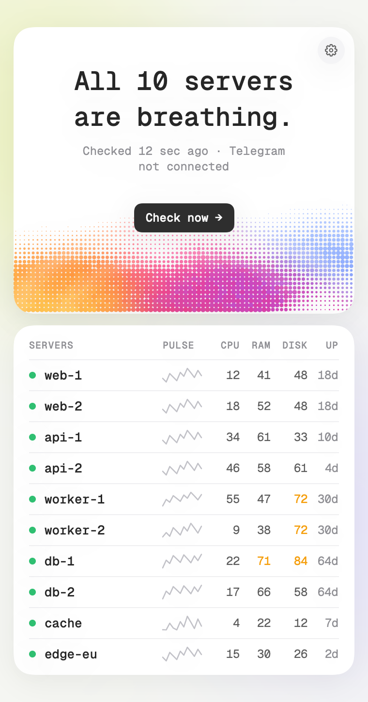
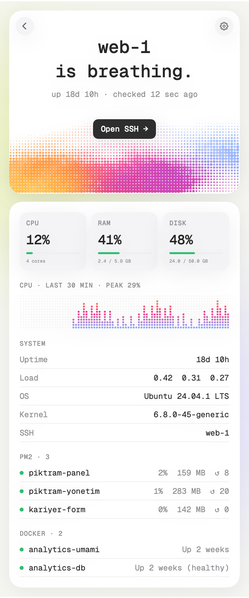
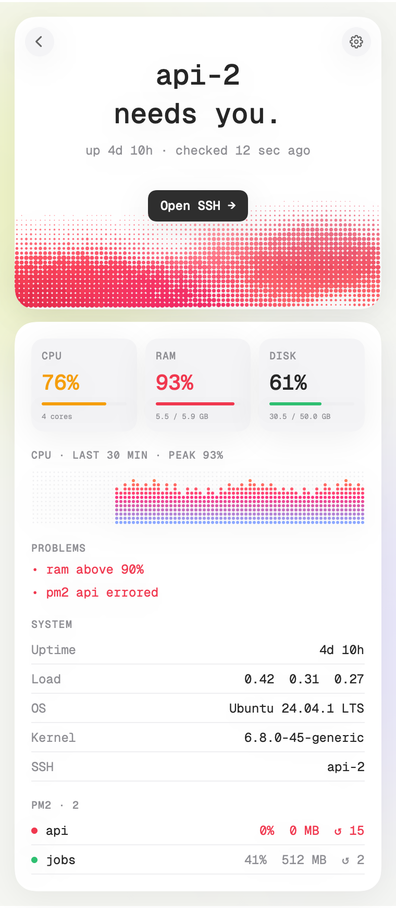

# Flatline

**Know before your server flatlines.**



Flatline watches your Linux servers and pings your Telegram the moment something breaks. A tiny menu bar app on your Mac shows every server's pulse at a glance, whether you run one server or twenty.

- 💓 **Pulse:** CPU, RAM, disk and uptime for every server, with a CPU sparkline
- 🔍 **Server pages:** click a server for its CPU history, memory and disk in GB, load, OS, pm2 apps, Docker containers and one-click SSH
- 🚨 **Telegram alerts** when a systemd service fails or stops, a pm2 app or Docker container dies, a disk fills up or a site goes down. Alerts add what was seen, like `HTTP 404`, `timeout` or `in 9 days`, and another message arrives when it recovers.
- 🌐 **Sites:** any error page counts as down (login walls don't), and you hear about an expiring certificate two weeks ahead
- 🔎 **Search-engine guard:** catches a stray `noindex`, a robots.txt that shuts out every crawler, a missing sitemap or missing HSTS before your rankings do
- 📜 **Logs:** a service that keeps restarting or piles up error lines, a pm2 app filling its error log, and bursts of 5xx or 429 answers in your nginx or Apache access log
- 🧰 **Maintenance:** pending security updates and a reboot the server is waiting for
- 🫀 **Heartbeat:** servers can watch each other, and an optional dead man's switch catches a server that dies completely
- 📌 **Live dashboard** pinned in your Telegram chat, kept fresh by the Mac app
- 🤝 **Share a server** with a partner through a one-time invite: they can see it, never log in
- 🫥 **No-install mode:** without the agent, the app reads a server once over SSH and writes nothing to it
- 🔒 **No open ports:** the Mac app reaches your servers over the SSH you already use, and the agent never listens for connections

Click a server to look inside. When something breaks, the art turns red and stops beating:

<p> </p>

## 1. Get the Mac app

Download **Flatline.dmg** from the [latest release](https://github.com/teqyiyen-del/flatline/releases/latest), open it and drag Flatline into Applications. You need macOS 14 or later, on Apple silicon or Intel.

Flatline isn't notarized by Apple yet, so the first time you open it macOS says it can't check it. Open **System Settings → Privacy & Security**, scroll down and click **Open Anyway**. You only do this once.

Then click the pulse icon in the menu bar and the gear in the top-right corner:

- **Servers:** add each server as an SSH destination, like `root@203.0.113.10` or an alias from `~/.ssh/config`. The app uses the SSH keys you already have.
- **Telegram:** open [@BotFather](https://t.me/BotFather) in Telegram, send `/newbot` and paste the token into Flatline. Send your new bot any message, then press **Connect**. Flatline finds your chat, keeps the token in your macOS Keychain and hands it to every server, so alerts keep coming even when your Mac is off. Give Flatline its own bot: two programs reading the same bot get in each other's way.

## 2. Install the agent on each server

```sh
curl -fsSL https://github.com/teqyiyen-del/flatline/releases/latest/download/install.sh | sudo bash
```

The installer downloads the agent from the same release, checks it against the release's SHA256 checksum and starts the `flatline` systemd service. You need Linux with systemd and Python 3.8 or newer (Ubuntu and Debian ship both). Run the same line again to update; your config is kept. To pin a version, put `FLATLINE_VERSION=v0.3.0` after `sudo`.

You can also connect Telegram on the server itself with `sudo flatline setup`.

## Share a server

Open a server in the app and create an invite. It works once and expires after 24 hours. Your partner pastes it into their own Flatline (gear → "Paste an invite") and the server shows up next to theirs.

Behind the scenes the invite holds a throwaway key that can only trade itself for your partner's own key. That key lands on the server as one line in the `flatline` account's `authorized_keys`, locked to a single command:

```
restrict,command="flatline status --json" ssh-ed25519 AAAA… partner
```

`restrict` turns off shells, terminals and tunnels, and `command=` means any other command still just prints the status. List and revoke access from the server's page, or with `sudo flatline access` and `sudo flatline revoke NAME`.

## No-install mode and removal

If a server has no agent, the app runs the same check once over SSH (`python3 - status --json --live`, fed from the app) and writes nothing to the server. You only give up alerts while your Mac is off.

To remove Flatline from a server, remove the server in the app and choose "Remove from server too", or run `sudo flatline uninstall`. It deletes the program, its service, its settings, its state and the sharing account.

## Configuration

Each server keeps its settings in `/etc/flatline.conf`. After editing, apply them with `sudo systemctl restart flatline`.

| Key | Default | What it does |
|---|---|---|
| `NAME` | hostname | Name shown in alerts and in the app |
| `DISK_MAX`, `RAM_MAX` | `90` | Alert when usage reaches this percentage |
| `INTERVAL` | `60` | Seconds between checks (10 to 3600) |
| `SITES` | | URLs to check, comma separated. No answer, a timeout, a certificate error or any answer of 400 or more counts as down, except 401 and 403: a login wall means the site is up |
| `PEERS` | | Other servers to watch, comma separated `name=host:port` |
| `HEARTBEAT_URL` | | Pinged on every check: [healthchecks.io](https://healthchecks.io), an Uptime Kuma push monitor, etc. |
| `IGNORE_UNITS` | `motd-news` | Failed systemd units to ignore (regex) |
| `SEO_SITES` | | Sites checked like `SITES`, plus a search-engine guard: a `noindex` header or meta tag, a robots.txt with `Disallow: /` for every crawler, a sitemap that doesn't answer, no HSTS on https. Looked at every 30 minutes |
| `CERT_DAYS` | `14` | Warn this many days before the certificate of an https site expires. `0` turns it off |
| `UNITS` | | systemd services that must keep running, comma separated (`nginx` means `nginx.service`). Alerts when one stops or keeps restarting |
| `LOG_ERRORS_MAX` | `0` | Alert when a service in `UNITS` or a pm2 app logs more error lines than this in one check. An error line is logged as an error or worse, or says error, exception, traceback, fatal or panic. `0` turns it off |
| `ACCESS_LOG` | | Full path of an nginx or Apache access log, like `/var/log/nginx/access.log` |
| `HTTP_ERRORS_MAX` | `20` | Alert when one check finds more 5xx answers, or more 429s, than this in `ACCESS_LOG` |
| `MAINTENANCE` | `yes` | Alert on pending security updates (Ubuntu, Ubuntu Pro's ESM ones included) and when the server needs a reboot. `no` turns it off |

A problem has to show up on two checks in a row before you get an alert, and has to be gone for two checks in a row before you hear it recovered, so short blips and flapping stay quiet. Alerts carry a short note on what was seen, like `• site example.com/en down · HTTP 404`. Notes are short facts like a status, a count or a package name, never log lines or secrets. If a check itself breaks, you get an alert about that too, never silence. pm2 and Docker are checked when they're installed; pm2 needs to be on the system `PATH`.

### Left out on purpose

- **Restarting or fixing things.** Flatline only reads. See [Security](#security).
- **Checking that DNS points at the right server.** Behind Cloudflare that tells you nothing, and broken DNS already fails the site check.
- **Comparing the code that's running with GitHub.** That needs repository credentials and write access on the server.
- **Checks inside your app's data.** Give your app a health URL that fails when data stops flowing, and add it to `SITES`.

## Security

- **No listener.** The agent opens no ports and accepts no connections. It only reads system state and makes outgoing requests to Telegram, the sites you list (with their robots.txt and sitemap for `SEO_SITES`) and your heartbeat URL. It never runs a shell and uses nothing outside the Python standard library.
- **Read-only on purpose.** Flatline never restarts a service, clears a disk or changes anything on your server. A monitor that can write to your server is a different, riskier tool: if it's ever fooled or broken, it can do damage. Flatline tells you, and you decide.
- **Sandboxed.** systemd runs it with no capabilities, a read-only file system apart from its own state folder, private `/tmp` and `/dev`, a system call filter and locked kernel settings. `systemd-analyze security flatline` rates it 2.0 (OK).
- **Log reading, counted only.** Debian and Ubuntu keep web server logs as `www-data:adm`, mode 640, so on those systems the service joins the `adm` group to read `ACCESS_LOG`. That group can also read logs like syslog. Flatline only counts lines in the logs it reads (the journal of your `UNITS`, pm2 error logs and `ACCESS_LOG`) and never sends their text anywhere.
- **Secrets stay put.** The bot token lives in `/etc/flatline.conf` (root only, mode 600) on servers and in the Keychain on your Mac. It never appears on a command line: the Mac app hands it over through SSH's standard input.
- **Strict input.** Tokens and chat IDs must match exact formats, config values can't contain line breaks, unknown config keys are ignored and numbers are clamped to safe ranges.
- **Two fixed commands.** Over SSH the app only ever runs `flatline status --json` and `flatline telegram`.
- **Verifiable releases.** Every release is built on GitHub from a tagged commit. Check what you downloaded:

  ```sh
  shasum -a 256 -c SHA256SUMS
  gh attestation verify Flatline.dmg --repo teqyiyen-del/flatline
  ```

- **Read before you run.** Rather not pipe into bash? Download `install.sh` and `flatline` from the release, read them (a few hundred lines), then run `sudo bash install.sh` next to them.

Found a security issue? Please report it privately, as described in [SECURITY.md](SECURITY.md).

## Commands

```sh
flatline status           # vitals and current problems
flatline status --json    # the same, for the app
sudo flatline setup       # connect Telegram from the server
journalctl -u flatline    # logs
```

## Uninstall

On a server, `sudo flatline uninstall`. On your Mac, quit Flatline from its settings and drag it from Applications to the Trash.

## Building from source

```sh
python3 agent/test_flatline.py   # alert logic, checks and config hardening, runs anywhere
sudo bash tests/e2e.sh           # breaks things for real on a throwaway Linux VM, never a real server
./app/build.sh                   # the Mac app, needs the Xcode Command Line Tools
./app/make-dmg.sh                # the disk image, needs: pip install dmgbuild
```

Flatline doesn't accept pull requests; see [CONTRIBUTING.md](CONTRIBUTING.md).

## License

MIT. The bundled Geist Mono font is licensed under the SIL Open Font License 1.1 (`app/Fonts/OFL-GeistMono.txt`).
